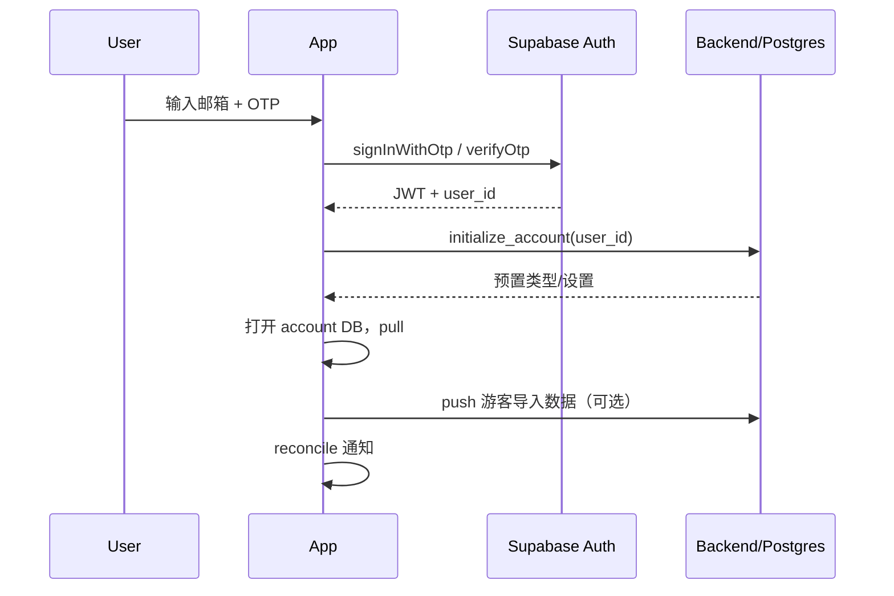
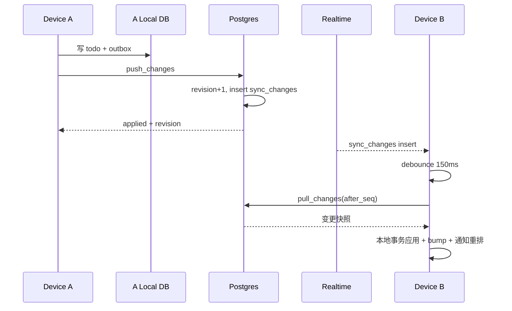
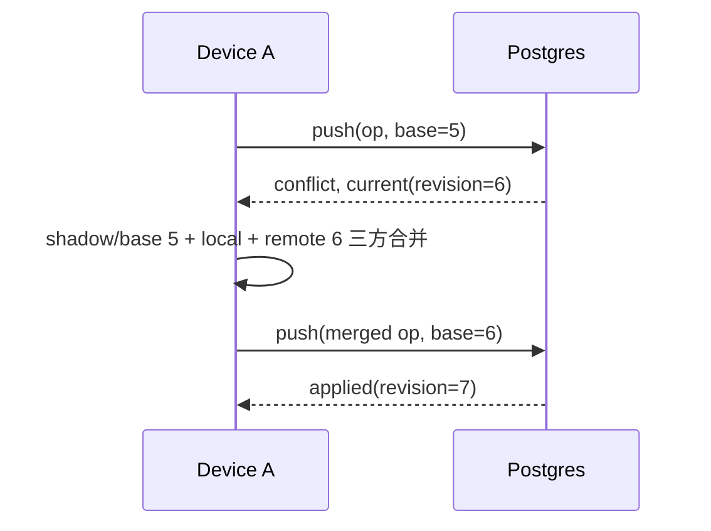

# 小陈待办 · 多设备账户同步技术方案

> 版本：v0.1（草案，待评审）  
> 日期：2026-10-25  
> 对应 App：v0.5.1  
> 范围：账户体系 + 多设备数据同步 + 实时更新；本文只做设计，不改代码

---

## 0. 结论先行

推荐采用 **local-first + 服务端权威变更日志** 的方案：

- **账户**：Supabase Auth，MVP 使用邮箱一次性验证码（邮箱 OTP），后续可加密码 / Google。
- **本地**：每个账户一个独立 SQLite 数据库，保持现有离线可用和即时操作体验；所有写操作先落本地。
- **服务端**：Supabase PostgreSQL + RLS + Realtime；`sync_changes` 作为唯一增量源，客户端按 `seq` 游标拉取。
- **同步**：本地 outbox 推送 + 服务端 revision 乐观并发 + HLC 最后写入胜出（LWW）+ 非重叠字段三方合并。
- **删除**：改为软删除 / tombstone，保留 30 天；类型子树删除与撤销使用 `delete_batch_id`。
- **实时**：App 前台通过 Supabase Realtime 订阅；启动、回前台、网络恢复、手动操作后立即补拉；后台只做尽力而为的周期同步。
- **通知**：仍是设备本地 Notifee 通知；同步后自动重排。**数据实时同步不等于另一台离线设备的本地闹钟能被实时撤销**，强一致需要后续接入 FCM / 服务端通知。
- **多账户**：v1 单设备只允许一个“活跃账户”同步和发通知；切换账户时取消旧账户通知、打开对应数据库。

**开工前需要先拍板的三件事：**

1. 后端部署区域：Supabase Cloud（新加坡）还是自托管香港/国内云？后者影响中国大陆网络可用性。
2. 邮箱 OTP 是否可接受？是否要同时支持密码 / Google。
3. 游客数据迁移策略：新账户是否自动导入本机数据；已有账户是否只允许“使用云端”，暂不自动合并。

---

## 1. 目标与非目标

### 1.1 目标

- 数据按账户隔离保存，登录后任何设备看到同一份数据。
- 本地操作即时生效，不等待网络；联网后自动推送。
- 多设备在线时，修改在秒级内出现在其他设备（前台）。
- 离线修改可恢复同步；删除、完成、撤销、类型调整都能跨设备传播。
- 冲突不阻塞使用、不丢关键数据、结果确定可解释。
- 保留现有游客/本地数据，不因上线账户体系丢数据。
- 通知在同步后正确重排；权限、精确闹钟、汇总时间继续可用。
- 服务端有 RLS，任何账户无法读写他人数据。

### 1.2 非目标（v1 不做）

- 共享清单 / 多人协作 / 成员权限。
- Web 端、iOS 端同步（协议可复用，但本期只做 Android）。
- 附件、图片、富文本。
- 端到端加密（E2EE）。
- 服务端推送通知 / FCM 唤醒（作为 Phase 2 可选项）。
- 多账户同时在线、同时收通知。
- 完整的 CRDT 富文本合并。

### 1.3 验收标准

- 设备 A 新建/编辑后，设备 B 前台 2 秒内看到（网络正常）。
- 设备 A 离线修改，恢复网络后自动同步，不需要手动点保存。
- 同一 todo 在两台设备同时改不同字段，两个字段都保留。
- 同时改同一字段，结果按 HLC 确定，不出现半条记录或 SQLite 损坏。
- 删除/撤销/类型删除/类型恢复在另一端可复现。
- 退出登录后，另一账户无法看到上一账户缓存数据。
- 设备 B 同步到“todo 已完成”后，本地到期通知被取消（B 在线/回前台后）。
- 已有本机数据首次登录新账户时可导入，且不重复出现预置类型。

---

## 2. 现状评估

### 2.1 当前实现（v0.5.1）

| 模块 | 现状 | 对同步的影响 |
|---|---|---|
| 数据库 | SQLite + Drizzle，schema v1，单文件 `xiaochen-todo.db` | 需要按账户切库 / 增加同步字段 |
| 主键 | `newId()`，`expo-crypto.randomUUID()` | 可直接用于多设备创建，避免 ID 冲突 |
| 预置类型 | 固定 ID：`preset-company`、`preset-self`、`preset-reading`、`preset-fitness` | 跨账户会重复；服务端必须用 `(user_id, id)` 复合主键 |
| 时间 | `created_at` / `updated_at` 为毫秒整数 | 需要新增 HLC / revision / server 时间 |
| 删除 | 硬删除；删除前取快照，撤销时 `INSERT OR REPLACE` | 多设备无法感知删除；需改软删除 + tombstone |
| 类型删除 | 删除子树 + 子树下所有 todo，快照恢复 | 要改成 batch 软删除 + 批量恢复 |
| 设置 | `settings(key,value)`，无时间/版本 | 需区分账户级设置与设备级设置 |
| 通知 | Notifee 本地触发；`due:<todoId>` / `summary:<日期>` | 多账户要加账户维度；同步后要重排 |
| 数据刷新 | `useDataVersion.bump()` 驱动页面和通知 reconcile | 同步应用远端变更后统一 bump 即可 |
| 账户 | 无 | 需要新增 Auth、账户态、切换、迁移 |
| 网络 | 无网络层 | 需要 Supabase client、NetInfo、重试 |

### 2.2 当前数据模型

```
types(id, parent_id, name, icon, sort_order, created_at, updated_at)
todos(id, name, type_id, priority, due_at, detail, completed_at, created_at, updated_at)
settings(key, value)
```

约束：

- `todos.type_id` 外键到 types，`types.parent_id` 自引用、级联删除。
- 同一父层级下类型名唯一（`COALESCE(parent_id,'') + name`）。
- 当前没有 `deleted_at`，没有版本号，没有服务端 ID。

这些在下一步都会改，但**用户可见的 UI 和数据字段基本不变**。

---

## 3. 总体架构

```
┌──────────────────────── Android App（每个账户一个 DB） ────────────────────────┐
│  UI / Zustand / Expo Router                                                  │
│        │ 本地读写（立即生效）                                                 │
│  Repository / MutationService                                                │
│        ├── SQLite（types/todos/settings + sync_meta/outbox/shadow）           │
│        └── useDataVersion.bump() ──► 通知 reconcile                          │
│                                                                              │
│  SyncEngine（单飞、串行、可重试）                                               │
│    ├── push：outbox → Supabase RPC                                           │
│    ├── pull：sync_changes(seq > cursor) → 本地事务                           │
│    └── Realtime：订阅 sync_changes(user_id) → 触发 debounce pull            │
└───────────────────────────────┬──────────────────────────────────────────────┘
                                │ HTTPS / WSS
┌───────────────────────────────▼──────────────────────────────────────────────┐
│ Supabase                                                                     │
│  Auth（邮箱 OTP）                                                             │
│  PostgreSQL（RLS：user_id = auth.uid()）                                     │
│    types / todos / settings / devices / sync_changes / sync_ops             │
│  Realtime（postgres_changes on sync_changes）                                │
└──────────────────────────────────────────────────────────────────────────────┘
```

### 3.1 组件职责

| 组件 | 职责 |
|---|---|
| AccountManager | 登录态、当前账户、切库、游客数据迁移、登出清理 |
| Local DB | 账户数据 + 同步元数据；所有写操作在本地事务中完成 |
| MutationService | 业务写 + 写 outbox + 生成 HLC；统一入口 |
| SyncEngine | push / pull / 冲突处理 / 游标 / 重试；同一账户单飞 |
| RealtimeClient | 订阅变更、重连、断线补拉；只做“有变化”的信号，不直接信 payload |
| NotificationBridge | 同步/本地写后 `reconcileNotifications()`；账户切换时取消旧通知 |

### 3.2 关键原则

1. **本地永远是第一写入点**，UI 不等待服务端。
2. **服务端是冲突和顺序的最终裁判**，但不阻塞本地编辑。
3. **所有远端变化都走 change log**，不用 `updated_at` 猜增量。
4. **所有写操作可重放、幂等**；重试不会产生重复数据。
5. **账户隔离发生在数据库文件层**，不只靠查询条件。

---

## 4. 账户、设备与数据隔离

### 4.1 登录方式

MVP：

- 邮箱 OTP（Supabase `signInWithOtp` + `verifyOtp`），无需密码、无需 Deep Link 回调，Android 体验简单。
- 后续可加邮箱+密码、Google；Apple 登录在 Android 上暂不需要。
- 会话 JWT + refresh token 存 `expo-secure-store`，不写 AsyncStorage 明文。
- Supabase client 配置 `autoRefreshToken`、`detectSessionInUrl: false`，AppState 回前台时刷新。

### 4.2 每账户一个 SQLite 数据库

- 游客库：`xiaochen-todo-local.db`（沿用现有 `xiaochen-todo.db` 改名/迁移）。
- 账户库：`xiaochen-todo-<user_id>.db`。
- 当前 `getSqlite()` 单例改为 `openAccountDatabase(accountId)`；切换账户时关闭旧连接、清空 Drizzle 实例、重置 stores。
- 数据库内不重复存 `user_id`（文件即隔离），只在 `sync_meta` 记录 `account_id` 做校验。

这样：

- 不需要给所有现有查询加 `where user_id = ?`，迁移风险小。
- 登出/切换时直接关闭文件，天然隔离。
- 两个账户的同名预置类型不会互相覆盖。

### 4.3 设备

- 首次启动生成 `device_id` UUID，存 SecureStore。
- 登录后向 `devices` 表注册/更新：设备名、平台、App 版本、最后在线时间。
- outbox 每条操作带 `device_id`，用于：
  - 忽略自己产生的 Realtime 回推；
  - 设备列表；
  - 冲突排查和审计。
- v1 不做“远程踢下线”，只做设备列表展示。

### 4.4 账户状态

```
未登录（游客库）
   │ 登录/注册
   ▼
当前账户（账户库）
   │ 切换账户
   ▼
另一个账户库（旧库保留；旧通知取消）
   │ 退出登录
   ▼
游客库 / 登录页（账户库按策略删除或保留）
```

v1 建议：

- 只允许一个活跃账户；切走时取消旧账户所有本地通知。
- 账户库保留在本机（便于快速切回），但退出登录时提供“同时删除本机缓存”选项；涉及隐私，默认删除更安全。
- 游客模式保留；用户可以先本地用，再登录。

### 4.5 游客数据迁移

**新账户（远端无数据）**：

1. 登录成功，服务端初始化账户（预置类型 + 默认设置）。
2. 提示“检测到本机 N 条待办、M 个类型，是否导入？”
3. 导入：把游客库复制为账户库，预置类型按 `(user_id, id)` 直接复用；所有行标记为 dirty，批量 push。
4. 不导入：使用云端数据，游客库保留。

**已有账户（远端有数据）**：

- v1 不自动合并（类型层级 / 同名 / 预置 ID 冲突复杂）。
- 提供两个选项：
  - **使用云端数据**（推荐）：游客数据保留在游客库，不丢。
  - **导入本机数据**：后续版本支持，把游客数据放入一个自动创建的根类型「本机导入 2026-10-25」，避免与云端类型树冲突。
- 明确提示，不做静默覆盖。

### 4.6 服务端预置类型

- 新账户由服务端 `initialize_account` RPC 初始化：4 个预置类型 + 默认设置。
- 新设备登录不再本地 `seedDatabase`，先拉取远端数据。
- 游客库仍由本地 `seedDatabase` 初始化。
- 预置 ID 继续使用 `preset-*`，服务端用复合主键 `(user_id, id)`，跨账户不冲突。

---

## 5. 数据模型

### 5.1 服务端表

> 所有业务表都带 `user_id`，复合主键 `(user_id, id)`；时间统一 `timestamptz`。

```sql
-- 账户资料
create table profiles (
  user_id uuid primary key references auth.users(id) on delete cascade,
  display_name text,
  created_at timestamptz not null default now(),
  updated_at timestamptz not null default now()
);

-- 设备
create table devices (
  id uuid primary key,
  user_id uuid not null references auth.users(id) on delete cascade,
  name text not null,
  platform text not null default 'android',
  app_version text,
  last_seen_at timestamptz,
  created_at timestamptz not null default now(),
  revoked_at timestamptz
);

-- 类型
create table types (
  user_id uuid not null references auth.users(id) on delete cascade,
  id text not null,
  parent_id text,
  name text not null,
  icon text not null,
  sort_order bigint not null,
  created_at timestamptz not null,
  updated_at timestamptz not null,
  deleted_at timestamptz,
  delete_batch_id uuid,
  revision bigint not null default 0,
  updated_hlc text not null,
  updated_by uuid not null,
  primary key (user_id, id),
  foreign key (user_id, parent_id) references types(user_id, id)
);

create unique index types_parent_name_uq
  on types(user_id, coalesce(parent_id, ''), name) where deleted_at is null;

-- 待办
create table todos (
  user_id uuid not null references auth.users(id) on delete cascade,
  id text not null,
  name text not null,
  type_id text not null,
  priority smallint not null check (priority between 1 and 4),
  due_at timestamptz,
  detail text not null default '',
  completed_at timestamptz,
  created_at timestamptz not null,
  updated_at timestamptz not null,
  deleted_at timestamptz,
  delete_batch_id uuid,
  revision bigint not null default 0,
  updated_hlc text not null,
  updated_by uuid not null,
  primary key (user_id, id),
  foreign key (user_id, type_id) references types(user_id, id)
);

-- 账户级设置（设备级设置不同步）
create table settings (
  user_id uuid not null references auth.users(id) on delete cascade,
  key text not null,
  value text not null,
  updated_at timestamptz not null,
  revision bigint not null default 0,
  updated_hlc text not null,
  updated_by uuid not null,
  primary key (user_id, key)
);

-- 变更日志：客户端增量的唯一来源
create table sync_changes (
  seq bigint generated always as identity primary key,
  user_id uuid not null references auth.users(id) on delete cascade,
  entity text not null check (entity in ('type','todo','setting')),
  entity_id text not null,
  op text not null check (op in ('upsert','delete','restore')),
  revision bigint not null,
  payload jsonb not null,
  device_id uuid,
  changed_at timestamptz not null default now()
);

create index sync_changes_user_seq_idx on sync_changes(user_id, seq);

-- 幂等：同一个 op_id 只应用一次
create table sync_ops (
  user_id uuid not null references auth.users(id) on delete cascade,
  op_id uuid not null,
  applied_at timestamptz not null default now(),
  primary key (user_id, op_id)
);
```

`payload` 存变更后的**完整行快照**，删除时保留 tombstone；这样客户端不需要重新查服务端。

### 5.2 服务端 RLS

```sql
alter table types enable row level security;
alter table todos enable row level security;
alter table settings enable row level security;
alter table sync_changes enable row level security;
-- profiles / devices 同样

create policy "own rows" on todos
  for select using (auth.uid() = user_id);

create policy "own changes" on sync_changes
  for select using (auth.uid() = user_id);
```

- 业务表**不开放客户端直接 insert/update/delete**；所有写入走 `push_changes` RPC（`security definer`，内部强制 `auth.uid()`）。
- `sync_changes` 只允许 select；插入由 RPC / trigger 完成。
- `sync_ops` 只由 RPC 写。
- service role key 永远不进 App。

### 5.3 本地数据库变更

新增列：

```sql
alter table types add column deleted_at integer;
alter table types add column delete_batch_id text;
alter table types add column revision integer not null default 0;
alter table types add column updated_hlc text not null default '';
alter table types add column updated_by text not null default '';

alter table todos add column deleted_at integer;
alter table todos add column delete_batch_id text;
alter table todos add column revision integer not null default 0;
alter table todos add column updated_hlc text not null default '';
alter table todos add column updated_by text not null default '';

alter table settings add column updated_at integer not null default 0;
alter table settings add column revision integer not null default 0;
alter table settings add column updated_hlc text not null default '';
alter table settings add column updated_by text not null default '';
```

新增同步表：

```sql
create table sync_meta (
  key text primary key,
  value text not null
);

create table sync_outbox (
  op_id text primary key,
  entity text not null,
  entity_id text not null,
  op text not null,
  base_revision integer not null,
  payload text not null,
  delete_batch_id text,
  created_at integer not null,
  attempts integer not null default 0,
  next_retry_at integer,
  last_error text
);

create table sync_shadow (
  entity text not null,
  entity_id text not null,
  revision integer not null,
  payload text not null,
  primary key (entity, entity_id)
);
```

`sync_meta` 记录：

- `account_id`
- `device_id`
- `last_seq`
- `last_sync_at`
- `last_error`
- `full_resync_required`
- `seeded`

### 5.4 软删除与撤销

- 所有查询默认加 `deleted_at IS NULL`；索引可改为部分索引。
- 删除 todo：`deleted_at = now`，写 tombstone outbox；撤销：`deleted_at = null`，写 restore。
- 删除类型子树：一个事务里给 type 子树 + 其 todos 打同一个 `delete_batch_id`；撤销按 batch 恢复。
- 服务端提供 `delete_type_subtree` / `restore_delete_batch` RPC；整个 batch 原子处理，写多条 change log。
- 保留 30 天；之后清理 tombstone。长期离线客户端走全量重建。
- 改名冲突（类型恢复时同名）：客户端沿用现有「已恢复」后缀逻辑；服务端唯一索引冲突返回 `name_conflict`，客户端重试改名后的版本。

### 5.5 设置的作用域

| key | 作用域 | 是否同步 |
|---|---|---|
| `reminders_enabled` | 账户 | 是 |
| `daily_summary_time` | 账户 | 是 |
| `sort_mode` | 账户 | 是（也可以选择设备级） |
| `notification_prompted` | 设备 | 否 |
| `seeded` | 本地 | 否 |
| 筛选、搜索、高亮 | 内存 | 否 |

服务端不存在 `notification_prompted`、`seeded`；新设备首次登录仍会重新申请通知权限。

---

## 6. 同步协议

### 6.1 本地写路径

所有写操作统一走：

```ts
await withLocalMutation(async (tx) => {
  // 1. 业务写入（insert/update/soft delete）
  // 2. 生成 HLC、更新 updated_at/updated_by
  // 3. 写 sync_outbox（payload = 完整行）
  // 4. 更新本地 revision（仍是上次服务端 revision）
});
useDataVersion.getState().bump();
```

- UI 成功与否只看 SQLite 事务，不等服务端。
- `useDataVersion` 继续承担页面刷新和通知重排。
- 通知重排不依赖网络；同步完成后再触发一次。

### 6.2 Push

- 同一账户一个 SyncEngine，单飞；所有入口合并为一次 `sync()`。
- 从 `sync_outbox` 按 `created_at, op_id` 取最多 50 条。
- 调 `push_changes(p_device_id, p_ops)`；每批一个事务。
- 结果：
  - `applied`：更新本地 revision / server 时间，删除 outbox，更新 shadow。
  - `conflict`：拿到服务端当前行，做三方合并，生成新 op（新 base），再次提交；最多 3 次。
  - `name_conflict` / `invalid_parent`：按业务错误处理，给出 rename 或回退根类型。
  - 网络/5xx：指数退避（1s、2s、4s…最长 5min），保留 outbox。
- 服务端 `sync_ops` 按 `(user_id, op_id)` 去重，重试安全。

### 6.3 Pull

- 用本地 `last_seq` 调 `pull_changes(after_seq, limit=200)`。
- 返回 `changes[] + next_seq + has_more`；客户端逐条在本地事务中应用：
  - 无本地 pending → 直接 upsert / 删除。
  - 有本地 pending → 不覆盖，标记冲突，进入 merge；待 push 完成后再拉一次。
  - 来自本机 `device_id` 的变更可跳过（已本地应用）。
- 更新 `sync_shadow`、`last_seq`；整个批次结束后只 bump 一次、通知 reconcile 一次。
- 若服务端返回 `full_resync_required`（游标超出日志保留期）→ 全量重建。

### 6.4 Realtime

- 登录后订阅：`postgres_changes` on `sync_changes`，filter `user_id=eq.<uid>`。
- 事件 payload 只当作“有新变更”的信号，**不直接应用**；debounce 150ms 后调 pull，保证顺序和游标一致。
- 订阅状态：
  - `SUBSCRIBED` → 立即 pull 一次。
  - `CHANNEL_ERROR` / `TIMED_OUT` → 指数退避重连；失败降级为前台 30s 轮询。
- 网络恢复、App 回前台、手动点击、push 成功后都触发一次 pull。
- Android 后台 WebSocket 可能被挂起；实时性只在 App 存活/前台时保证。周期后台任务仅做补同步。

### 6.5 全量重建

触发条件：

- 本地游标早于 `sync_changes` 保留期（30 天）。
- 检测到 shadow 与本地 revision 不一致且无法修复。
- 用户手动“修复同步”。

流程：

1. 先尝试推完所有 pending（冲突先合并或放弃）。
2. 服务端 `get_snapshot()` 分页返回所有 live + tombstone 行及快照 `seq`。
3. 本地事务替换非 pending 行；本地存在但远端不存在且非 pending 的行删除。
4. 写入快照 `seq`，再拉快照之后的增量。

### 6.6 接口草案

```ts
// 推送
rpc('push_changes', {
  p_device_id: string,
  p_ops: Array<{
    op_id: string;
    entity: 'type' | 'todo' | 'setting';
    entity_id: string;
    op: 'upsert' | 'delete' | 'restore';
    base_revision: number;
    hlc: string;
    payload: Record<string, unknown>; // 完整行
    delete_batch_id?: string;
  }>;
});

// 返回
{
  results: Array<{
    op_id: string;
    status: 'applied' | 'conflict' | 'error';
    revision?: number;
    current?: Record<string, unknown>; // conflict 时返回服务端当前行
    code?: 'name_conflict' | 'invalid_parent' | 'invalid_payload';
  }>;
  latest_seq: number;
}

// 拉取
rpc('pull_changes', { p_after_seq: number, p_limit?: number });
// => { changes: Change[], next_seq, has_more, full_resync_required }

// 全量
rpc('get_snapshot', { p_cursor?: number, p_limit?: number });
```

服务端 `push_changes` 内部：

1. `auth.uid()` 取用户；校验 `p_device_id` 属于该用户。
2. 对每条 op：
   - `sync_ops` 插入 `(user_id, op_id)`；冲突则说明重复，直接返回已应用结果。
   - 查当前行；若 `current.revision != base_revision` → 返回 `conflict` + current。
   - 校验 parent 不自环、type 属于同一用户、name 不冲突。
   - 若 `hlc <= current.updated_hlc` → 返回 conflict/忽略，避免旧写入覆盖新写入。
   - 更新行：`revision = current.revision + 1`、`updated_hlc`、`updated_by`。
   - 写 `sync_changes` 完整快照。
3. 返回结果和最新 seq。

所有操作在一个 Postgres 事务中；要么整批成功，要么整批回滚，避免部分应用。

---

## 7. 冲突处理

### 7.1 时钟

新增 **HLC（Hybrid Logical Clock）**，格式固定、可直接字符串排序：

```
0000018f0c9e2a10-0001-<device_id前8位>
（physical_ms 16位十进制 - counter 4位 - device 短 id）
```

- 每次写：`max(now_ms, last_physical) + counter`；同毫秒递增 counter。
- 跨设备比较按字符串；相同 HLC 用 device_id 兜底。
- `updated_at` 仍保留真实墙钟，用于展示和通知；合并只看 HLC。
- 为什么不只用设备时间：手机时钟可能被手动调整；HLC 至少保证因果顺序和稳定 tie-break。

### 7.2 三方合并

每个实体在本地 `sync_shadow` 保存“最后一次看到的服务端版本”。冲突时：

```
base   = shadow.payload
local  = 当前本地行
remote = push/sync 返回的服务端当前行
```

字段规则：

| 场景 | 处理 |
|---|---|
| 只有 local 改了字段 | 保留 local |
| 只有 remote 改了字段 | 采用 remote |
| 两边都改成相同值 | 采用该值 |
| 两边改成不同值 | 比较该实体/字段的 HLC，较大者胜出 |
| local 删除、remote 编辑 | 删除优先（除非 remote 是 restore 且 HLC 更新） |
| local 编辑、remote 删除 | 删除优先；若用户刚编辑，提示“该待办已在其他设备删除” |
| 类型 parent 冲突 | HLC 胜出后校验不成环；成环则回退到根类型并提示 |
| 排序冲突 | 整个 siblings 排序作为一次操作，HLC 胜出；不做逐项合并 |
| 类型重名 | 服务端返回 `name_conflict`；客户端加后缀或提示用户改名 |

### 7.3 为什么不用纯 CRDT

- 当前业务是个人 todo：LWW + 三方合并已经足够，复杂度远低于 CRDT。
- 类型树/排序用 CRDT 收益有限，反而增加实现和调试成本。
- 如果后续做共享清单/多人协作，再评估 Yjs/Automerge 或字段级 CRDT。

### 7.4 冲突 UX

- 默认不弹窗、不阻塞；同步完成后如发生覆盖，Snackbar 提示“已合并其他设备的修改”。
- 同一字段被覆盖不生成副本；如果后续需要“绝不丢内容”，可对 `detail/name` 生成一条“冲突副本”待办。
- `sync_conflicts` 可选记录最近冲突，用于排查；v1 只写日志。

---

## 8. 实时、后台与网络

### 8.1 触发时机

- App 启动、登录、切换账户。
- 回到前台（AppState active）。
- 网络从离线变在线（NetInfo）。
- Realtime 收到变更（debounce 150ms）。
- 本地写成功后 100ms（合并批量）。
- push 成功后。
- 手动“立即同步”。
- 后台周期任务（可选，15 分钟级）。

### 8.2 客户端状态机

```
idle → syncing → idle
         │
         ├── offline（保留 outbox，等待网络）
         ├── error（指数退避，展示“同步失败”）
         └── conflict（合并后重试，最多 3 次）
```

状态对外暴露：

- `lastSyncedAt`
- `pendingCount`
- `syncing`
- `offline`
- `errorMessage`

UI 建议在「我的」页显示“已同步 / 同步中 / 离线 / N 条待上传”，不打扰主流程。

### 8.3 后台限制

- Android 后台 WebSocket 不可靠；Supabase Realtime 仅保证 App 活跃时实时。
- 如需“另一台设备完成 todo，本机立刻取消闹钟”，必须：
  - FCM 数据推送唤醒 App，或
  - 改由服务端统一发通知。
- v1 接受“回前台补同步”的最终一致性；后台周期任务只作为兜底。

---

## 9. 通知与多设备

### 9.1 现状

- Notifee 本地触发；到期提醒 `due:<todoId>`，汇总 `summary:<yyyy-MM-dd>`。
- 无服务端推送；通知完全依赖本机数据库和排程。

### 9.2 同步后的行为

- 每次 pull/本地写后 bump 数据版本，现有 `NotificationBootstrap` 会 `reconcileNotifications()`。
- 完成/删除/改 due 后，下一轮 reconcile 取消或重排。
- 账户级设置 `reminders_enabled` / `daily_summary_time` 同步后重排。
- 设备级通知权限/精确闹钟状态不同步；换设备需重新授权。

### 9.3 多账户

- v1 只有活跃账户排通知。
- 切换账户：先 `cancelAllReminders()`，再打开新账户库、同步、重排。
- 通知 ID/data 增加账户维度：
  - ID：`acct:<userId>:due:<todoId>`
  - data：`{ kind:'due', accountId, todoId }` / `{ kind:'summary', accountId }`
- 点击旧账户通知时，如果当前不是该账户：
  - 先切换账户，再进入详情；或提示“该通知属于另一个账户”。
  - 推荐自动切换，体验更顺。

### 9.4 已知一致性缺口

| 场景 | v1 行为 |
|---|---|
| A 完成 todo，B 离线且 App 未运行 | B 的本地闹钟仍可能触发，直到 B 下次同步 |
| A 删除 todo，B 有已排程通知 | 同上 |
| B 的时区/系统时间变化 | 本地重排；HLC 不受影响 |
| 多账户 | 旧账户通知已取消，但通知栏残留点击走账户校验 |

**强一致方案（Phase 2）**：服务端保存设备 FCM token，数据变更后推送 data-only 消息唤醒 App 补同步；或服务端统一发提醒，本地只做展示。后者改动更大，需重新设计 P4 通知链路。

### 9.5 每日汇总

- 账户级时间，按设备本地时区排 14 天。
- 同步后重排；设备 A 修改时间，设备 B 下次同步后生效。
- 汇总内容仍泛化，不依赖服务端实时统计。

---

## 10. 后端选型与部署

### 10.1 候选项

| 方案 | 优点 | 缺点 | 适用 |
|---|---|---|---|
| Supabase（推荐） | Postgres + RLS + Auth + Realtime 一体；SQL 与当前 Drizzle 心智接近；可自托管 | 中国大陆直连不稳定；自托管运维成本 | 个人/小团队，快速 MVP |
| Firebase | 离线/实时成熟；SDK 简单 | 非 SQL；国内不可用；厂商锁定 | 海外用户为主 |
| 自建 NestJS/Go + Postgres + WebSocket | 完全可控；可部署国内；可做 FCM | 开发/运维量大；要自己做认证、RLS | 长期/国内合规 |
| 腾讯云 CloudBase | 国内可用；认证/数据库/实时 | 文档型、规则与 SQL 不同；迁移成本 | 国内用户、接受厂商 |

### 10.2 推荐

**MVP 推荐 Supabase**，协议层不绑定 Supabase 细节：

- 本地开发：`supabase start` + migrations + seed。
- 生产：优先 Supabase Cloud（新加坡）；若中国大陆网络是硬要求：
  - 自托管 Supabase 到腾讯云/阿里云香港（无需 ICP，通常可直连）；或
  - 仅把 Postgres + Auth + 自建 WebSocket 迁到国内云，RPC/change log 设计不变。
- Realtime 只用于“有变更”的信号；即使换掉 Realtime，改为 15s 轮询也能工作（实时性下降）。

### 10.3 其他

- 数据库迁移放 `supabase/migrations`，与 App 版本分开。
- 备份：Supabase 自动备份；额外每日导出。
- 观测：RPC 错误率、同步延迟、change log 增长、Realtime 连接数。
- 成本：早期免费/Pro 足够；主要成本是 Auth MAU + 数据库/带宽。

---

## 11. 客户端改造

### 11.1 目录建议

```
src/sync/
  types.ts           # Change/Op/SyncStatus
  clock.ts           # HLC
  account-db.ts      # 账户库选择、关闭、迁移
  outbox.ts          # 本地 outbox 读写
  shadow.ts          # shadow 读写
  engine.ts          # push/pull/状态机/重试
  realtime.ts        # Supabase Realtime 订阅
  merge.ts           # 三方合并
  api.ts             # RPC 封装
src/stores/account.ts
src/stores/sync.ts
src/app/account/   # 登录、账户、设备、同步状态
supabase/migrations/
  ...sql
```

### 11.2 需要改的现有模块

| 模块 | 改动 |
|---|---|
| `db/client.ts` | 单例 → 账户库工厂；关闭/切换 |
| `db/bootstrap.ts` | 按账户迁移；游客/账户不同 seed 策略 |
| `db/todo-repository.ts` | 软删除、batch、outbox、revision/HLC |
| `db/type-repository.ts` | 软删除子树、batch 恢复、outbox、排序 |
| `db/settings-repository.ts` | 账户/设备作用域；outbox |
| `db/index.ts` | 导出同步 API |
| `_layout.tsx` | 启动时恢复会话、打开账户库、启动 SyncEngine |
| `NotificationBootstrap` | 账户切换取消旧通知；同步后 reconcile |
| `settings.tsx` | 账户设置 + 设备权限分组；同步状态入口 |
| `stores/settings.ts` | 账户切换后重新 load |
| 所有 repository 调用方 | 基本不变（写路径封装在 repository/Service 内） |
| 通知 scheduler | 账户维度 ID/data；仅活跃账户 |
| `useTypeDeletion` / undo | 软删除 batch + restore；同步 |
| 迁移 | schema v2：软删除、同步列、同步表 |

### 11.3 关键实现约束

- **不要让 UI 直接调 Supabase**；只通过 SyncEngine。
- **不要在 SQLite trigger 里写 outbox**（事务/顺序难控）；在 repository 层显式写。
- **同步应用远端变更必须在一个 SQLite 事务中**；避免 UI 看到半条数据。
- **每个账户的 SyncEngine 单飞**；切换账户时取消旧任务。
- **失败不能阻塞本地使用**；outbox 持久化。
- **登录前不启动同步**；游客库不同步。
- **同步表本身不进 remote**。

---

## 12. 安全与隐私

- 所有业务表启用 RLS；客户端只拿 anon key，不使用 service role。
- RPC 内部强制 `auth.uid()`，不信任客户端传入的 `user_id`。
- JWT / refresh token 存 SecureStore；退出登录清除。
- 本地 SQLite 默认不加密；v1 依赖系统沙箱 + 锁屏；如需要更高安全，后续评估 SQLCipher。
- 账户删除：删除 `auth.users` 行级联业务数据；本地账户库删除；保留 30 天冷静期可选。
- 数据导出：提供 JSON 导出（后续）。
- 日志不打印待办正文、邮箱、token。
- Realtime channel 只订阅自己的 `user_id`；服务端 RLS 兜底。
- 防滥用：Supabase Auth 限流；RPC 限制单批 50 条 / 1MB；change log 保留 30 天。

---

## 13. 迁移与兼容

### 13.1 本地迁移

1. schema v2：新增同步列/表；现有数据 `revision=0`、`updated_hlc` 由 `updated_at` 生成。
2. 硬删除逻辑改为软删除；旧数据没有 tombstone，历史已删数据无法恢复，符合预期。
3. 当前库 `xiaochen-todo.db` 迁移为游客库 `xiaochen-todo-local.db`；账户库按需创建。
4. 预置类型：账户新库由服务端初始化；游客库本地 seed；不再对已有账户库无条件 seed。
5. 通知 ID 兼容：升级时取消旧 `due:`/`summary:` 触发，按新账户格式重排。

### 13.2 服务端迁移

- `supabase/migrations` 按时间顺序；先建表/RLS/函数，再接客户端。
- 新账户初始化函数；旧数据（无）无需回填。
- 所有客户端版本都需要服务端兼容；旧版本 0.5.1 不登录不影响。

### 13.3 发布顺序

1. 发布“本地软删除 + 同步表 + 账户 UI 隐藏”的 0.6.0（同步开关关闭），验证无回归。
2. 后端 + Auth 上线；内部账户测试。
3. 开启同步 beta；先支持“新账户/游客数据导入”。
4. 再接已有账户合并、FCM/后台优化。

---

## 14. 分阶段与工作量

| 阶段 | 内容 | 估算（单人） |
|---|---|---|
| P0 本地基座 | schema v2、软删除、batch、outbox、shadow、HLC、通知兼容 | 4–5 天 |
| P1 账户与后端 | Supabase 项目、Auth、表/RLS/RPC、账户库、登录 UI、游客迁移 | 5–7 天 |
| P2 同步核心 | push/pull、游标、幂等、重试、三方合并、冲突 UI、全量重建 | 6–8 天 |
| P3 实时与通知 | Realtime、网络/前后台、账户切换通知、设备列表 | 4–6 天 |
| P4 硬化 | RLS/安全测试、双设备 e2e、性能、监控、文档 | 4–5 天 |
| 合计 | | **23–31 个工作日** |

建议先做垂直切片：**登录 + todos push/pull + 手动同步 + 一个双设备场景**（约 5–7 天），跑通后再扩展 types/settings/实时。

---

## 15. 测试计划

### 15.1 必测矩阵

- 双设备/双模拟器：A 新建 → B 出现；B 修改 → A 出现。
- 离线：A 离线改 10 条 → 恢复 → 全部上传且顺序正确。
- 冲突：两边改不同字段 → 合并；两边改同一字段 → HLC 稳定。
- 删除/撤销：A 删除 → B 消失；A 撤销 → B 恢复。
- 类型：A 删除子树 → B 级联消失；恢复 → B 恢复；同名冲突。
- 账户：A 账户 1 → 切账户 2 → 通知取消、数据不串；RLS 越权测试。
- 认证：token 过期、刷新、断网登录、退出重登。
- 实时：Realtime 断线重连、重复事件、乱序事件、游标跳变。
- 全量重建：清空本地游标、超过保留期、强制修复。
- 通知：完成/删除/改 due 后取消；汇总时间变更；账户切换。
- 迁移：0.5.1 → 0.6.0；游客数据导入；预置类型不重复。
- 性能：1000/5000 条 todos 的 pull 与页面刷新；同步不卡 UI。
- 时钟：手动改设备时间、跨时区。

### 15.2 服务端测试

- RLS：用户 A 不能 select/写用户 B。
- RPC：伪造 user_id、重复 op_id、非法 parent/priority/entity、超大 payload。
- change log：seq 单调、事务原子、删除快照。
- 并发：两个客户端同时 push 同一 todo。

---

## 16. 风险与对策

| 风险 | 影响 | 对策 |
|---|---|---|
| 冲突覆盖用户输入 | 数据丢失 | 三方合并 + HLC + 冲突日志；关键字段后续可加副本 |
| 中国大陆无法稳定访问 Supabase | 同步不可用 | 先确认部署区域；自托管香港/国内或换后端 |
| 本地闹钟无法实时撤销 | 过期提醒 | v1 说明最终一致；Phase 2 FCM |
| 多账户/游客迁移复杂 | 数据串/丢失 | v1 限制活跃账户；新账户导入；已有账户不自动合并 |
| 类型树成环/重名 | 数据异常 | 服务端校验 + 客户端回退 + 唯一索引 |
| 硬删除改软删除回归 | 列表/统计/唯一索引错 | schema 测试 + 全查询审查 |
| outbox 重复/乱序 | 重复数据 | op_id 幂等 + 单飞 + 服务端事务 |
| RLS 配置错误 | 越权 | 自动化 RLS 测试；禁止 service role 进客户端 |
| 后台不同步 | 实时性不达预期 | 明确“前台实时、后台最终一致”；可选 FCM |

---

## 17. 待确认决策

1. **后端与区域**：Supabase Cloud 新加坡 / 自托管香港 / 国内云？这决定网络和合规。
2. **登录**：邮箱 OTP 是否可接受？是否需要密码或 Google。
3. **游客迁移**：新账户自动导入本机数据；已有账户是否接受“仅使用云端，不自动合并”？
4. **冲突**：同一字段冲突按 HLC LWW 是否可接受？是否需要“冲突副本”？
5. **通知**：是否接受 v1 的跨设备通知最终一致？是否排期 FCM？
6. **多账户**：单设备单活跃账户是否够用？
7. **设置**：`sort_mode` 是否账户级同步？
8. **数据保留**：tombstone/change log 30 天是否足够？

**建议默认**：Supabase Cloud 新加坡 + 邮箱 OTP + 新账户导入/已有账户仅云端 + LWW 三方合并 + v1 不做 FCM + 单活跃账户 + sort_mode 同步 + 保留 30 天。

---

## 18. 附：关键流程

### 18.1 首次登录（新账户）



### 18.2 实时修改



### 18.3 冲突重试



---

## 19. 代码层改造清单（供排期）

- [ ] `supabase/` 工程 + migrations + RLS + RPC + seed
- [ ] `src/sync/clock.ts` HLC + 单元测试
- [ ] `src/sync/merge.ts` 三方合并 + 测试
- [ ] `src/db/migrations.ts` v2：同步列/表/软删除索引
- [ ] `src/db/client.ts` 账户库工厂 + 关闭/切换
- [ ] `src/db/bootstrap.ts` 游客/账户启动策略 + 会话恢复
- [ ] `src/db/*repository.ts` 软删除 + outbox + revision
- [ ] `src/sync/engine.ts` push/pull/状态机/重试/全量
- [ ] `src/sync/realtime.ts` 订阅/重连
- [ ] `src/stores/account.ts` + 登录/账户 UI
- [ ] `src/stores/sync.ts` + 同步状态 UI
- [ ] `NotificationBootstrap` 账户切换 + 重排
- [ ] 设置页账户/设备分组
- [ ] 双设备 e2e 脚本/测试
- [ ] README / 运维文档

---

> 本文为方案草案。确认第 17 节决策后，再拆成可执行的实现任务和数据库迁移。
